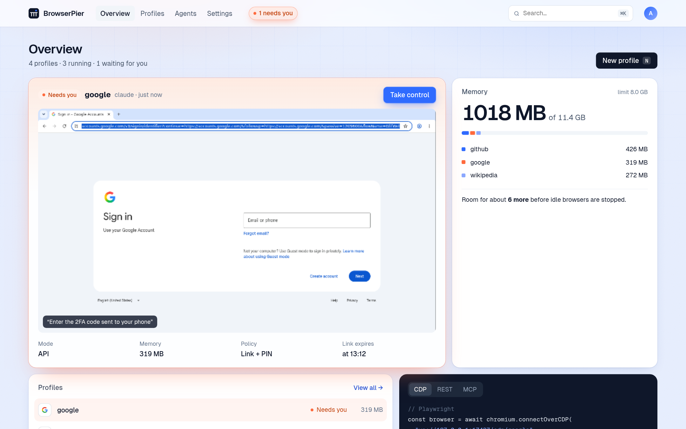
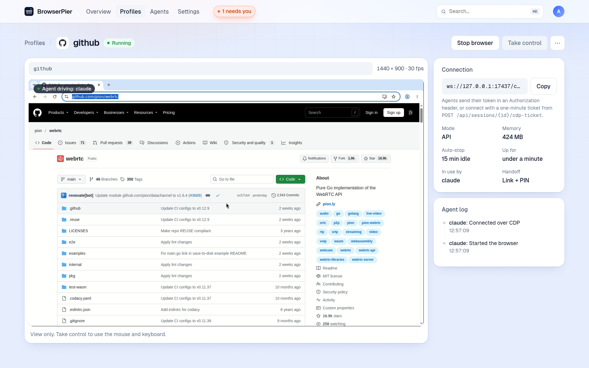
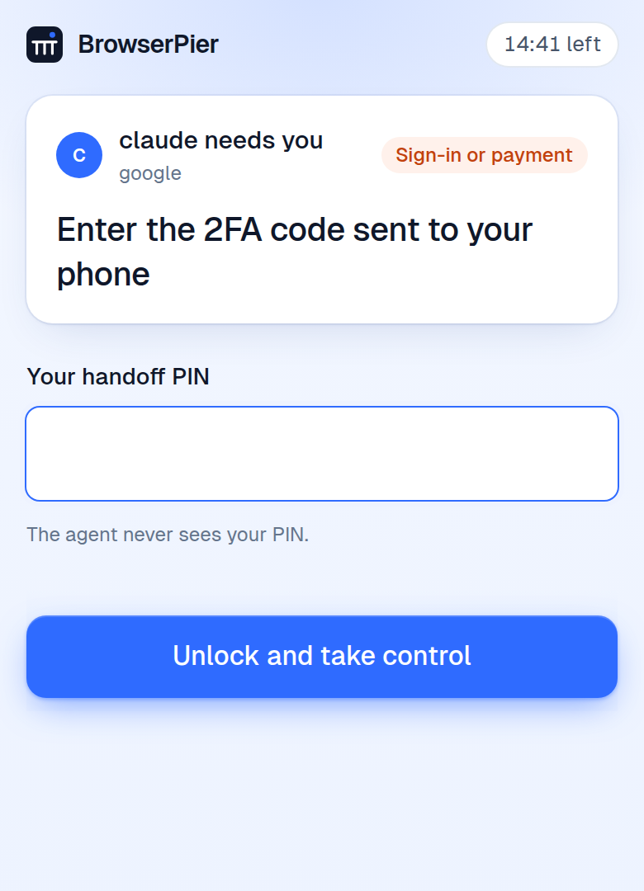

# BrowserPier

**Self-hosted browsers for AI agents: signed in once, kept signed in, with you one tap away.**



Agents get stuck on the same few things in a browser: signing in, 2FA, a CAPTCHA, a fresh browser every time. BrowserPier runs one real Chromium per profile (`github`, `google`, …) on your own server. You sign in once, and the login stays. An agent starts the browser when it needs one, and it stops when idle, so an idle profile uses no memory. When the agent reaches a step only you can do, it sends you a one-time link. You open it on your phone, do the step and hand the browser back.

## What you get

- **Logins that stay.** Each profile is one real, stable Chromium in its own container. Cookies and logins survive stops, restarts and updates, and Chromium is always closed gracefully before its container stops.
- **A person when it matters.** Handoff links are single-use, last 15 minutes and give control of one browser only. They ask for your PIN by default, or your password for email or banking. The agent waits, then carries on once you hand back.
- **Watch, or take over, from any browser.** The live view streams over WebRTC, with no VNC client to install, and works on a phone.
- **Two ways to drive:**
  - **API mode:** CDP for Playwright, Puppeteer, browser-use and similar.
  - **Visual mode:** screenshots plus real OS-level mouse and keyboard, with no automation attached to the page, for sites with heavy bot detection.
- **Any agent.** Agents can use the MCP endpoint (Claude Code, Codex, Cursor and others), the REST API or CDP. Each agent gets its own token, limited to the profiles you choose.
- **Your connection.** On a home server, sites see your home connection, not a datacenter. A profile can use a proxy instead, and its time zone and language follow wherever it exits.
- **Light on your server.** Browsers start on demand and stop when idle. A memory limit, and a check of what the host has free, keep them from starving your other apps.

What it doesn't do: it doesn't fake fingerprints, guarantee getting past every bot check, or serve several users. There's one admin: you.

## Install

You need Docker and about 1–2 GB of memory for each browser you'll run at once.

**Umbrel:** in the App Store, open ⋯ → Community App Stores and add `https://github.com/Oni-giri/yakitoris-app-store`, then install BrowserPier. Its admin password is the app password Umbrel shows under BrowserPier → Info.

**Docker Compose,** on a VPS or a home server:

```sh
umask 077 && mkdir browserpier && cd browserpier
release=https://github.com/Oni-giri/browser-pier/releases/latest/download
curl -fsSLO $release/docker-compose.yml
curl -fsSLO $release/Caddyfile
curl -fsSL  $release/env.example -o .env
install -d -m 700 data
# fill in .env: your user, the Docker group and how you'll reach it
docker compose up -d                   # Tailscale, or your own proxy
docker compose --profile https up -d   # or this, with the bundled Caddy
```

[deploy/README.md](deploy/README.md) has the rest:
- Tailscale, or a domain with HTTPS through the bundled Caddy
- the firewall
- the first-run setup code
- every setting
- updates and backups

**Then, in BrowserPier:**
1. **Settings:** set a handoff PIN.
2. **Profiles:** create a profile, start it, take control in the live view and sign in to its site once.
3. **Agents:** create a token for each agent.



## Connect your agent

Put the agent's token in the `PIER_TOKEN` environment variable wherever the agent runs.

**Any agent:** paste this into its chat. The Agents page shows it with your address filled in:

> Connect yourself to my BrowserPier: read https://pier.example.com/mcp/setup (with curl if you can) and follow it. My agent token is in the PIER_TOKEN environment variable.

`/mcp/setup` is a guide written for agents. It tells each client how to add the MCP server: Claude Code, Codex, Gemini CLI, Cursor, VS Code, Cline, Windsurf, OpenCode or Goose. Its config reads the token from the variable, so the token never goes through the chat. Agents that can't use MCP get the same steps over the REST API.

**Or add the MCP server yourself:**

```sh
# Claude Code (keep the single quotes: the token is read at each connection)
claude mcp add --transport http browserpier https://pier.example.com/mcp \
  --header 'Authorization: Bearer ${PIER_TOKEN}'

# Codex
codex mcp add browserpier --url https://pier.example.com/mcp --bearer-token-env-var PIER_TOKEN
```

**Playwright, over CDP:**

```python
import os, requests
from playwright.sync_api import sync_playwright

base = "https://pier.example.com"
auth = {"Authorization": "Bearer " + os.environ["PIER_TOKEN"]}
s = requests.post(base + "/api/sessions", json={"profile": "github", "mode": "api"}, headers=auth).json()

with sync_playwright() as p:
    browser = p.chromium.connect_over_cdp(s["cdp_url"], headers=auth)
    page = browser.contexts[0].pages[0]
    page.goto("https://github.com/notifications")
# The browser stops by itself once idle (unless its profile says never), and
# the login is kept. Another agent may be using it too, so this doesn't stop it.
```

**REST, in Visual mode:**

```sh
H="Authorization: Bearer $PIER_TOKEN"
curl -s -X POST https://pier.example.com/api/sessions -H "$H" -d '{"profile": "github", "mode": "visual"}'
curl -s https://pier.example.com/api/sessions/ID/screenshot -H "$H" -o screen.png
curl -s -X POST https://pier.example.com/api/sessions/ID/computer -H "$H" \
  -d '{"action": "click", "x": 640, "y": 360, "screenshot": true}' -o screen.png
```

## When the agent needs you



1. The agent asks for a handoff, with a reason and a detail ("Enter the 2FA code sent to your phone").
2. BrowserPier gives it a one-time link. MCP clients that can show links, such as Claude, show it to you directly. Other agents send it through their own channel: chat, Telegram, Slack. BrowserPier sends no notifications of its own.
3. You open the link, enter your PIN and take control of the live view. Meanwhile the agent is paused.
4. You tap **Done, hand back** or **Can't do this**, with a note if you like.
5. The agent gets your answer and carries on.

Each profile has a handoff policy:
- **Link only:** for low-stakes sites.
- **Link + PIN:** the default.
- **Full sign-in:** your admin password, for email, banking and payments.

An agent can raise the level for one handoff, but never lower it.

<br clear="right">

## How it works

```
 agents ──REST / MCP / CDP──▶  BrowserPier (Go, always on)  ◀──WebRTC──  you (UI, live view, handoff)
                                   │  Docker
                                   ▼
                      one browser container per running profile
                      (headful Chromium + Xvfb + xdotool + H.264 stream)
                                   │
                      one persistent folder per profile
```

BrowserPier is one small Go program, with its web UI built in. It starts a browser container for each running profile, only ever from its own browser image. Those containers publish no ports: CDP, the live view and the screenshots all go through BrowserPier, behind its token checks. Text from web pages reaches agents marked as untrusted content, with invisible characters and HTML comments stripped and password and one-time-code fields redacted.

[SPEC.md](SPEC.md) has the full design and the decisions behind it.

## Security

A profile holds live, signed-in sessions, so anyone who can drive it can act as you on those sites. Some precautions:
- Keep BrowserPier private, on Tailscale or a VPN, when you can. If it's public, use HTTPS.
- Give each agent its own token, limited to the profiles it needs.
- Set a handoff PIN, and use Full sign-in for accounts that matter.

BrowserPier starts browsers through the Docker socket, which controls the host. [deploy/README.md](deploy/README.md#the-docker-socket) explains what limits that risk.

## Status

BrowserPier is early (0.x) and moving fast. See the [changelog](CHANGELOG.md) and the [releases](https://github.com/Oni-giri/browser-pier/releases). [ANTI-BOT.md](images/chromium/ANTI-BOT.md) shows how Visual mode does on public bot-detection pages, and what still gives it away.

## Contributing

See [CONTRIBUTING.md](CONTRIBUTING.md) to set up a machine (Go, golangci-lint, Docker and the GitHub CLI), build it, run the tests and see how changes are made. Coding agents start with [AGENTS.md](AGENTS.md).

## License

[Apache 2.0](LICENSE).

Several ideas come from [Steel Browser](https://github.com/steel-dev/steel-browser) (Apache 2.0); see [NOTICE](NOTICE) and the credits in [SPEC.md](SPEC.md#credits).
